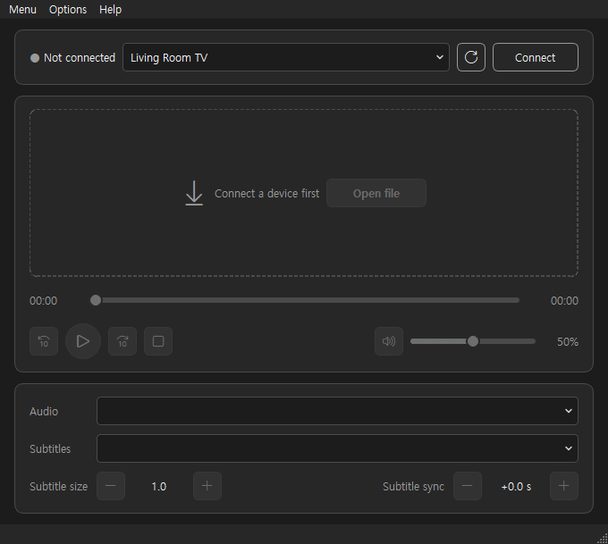
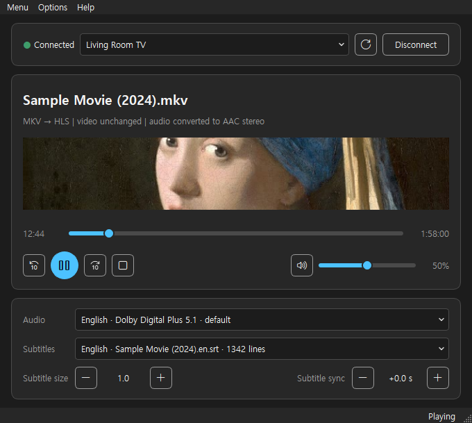
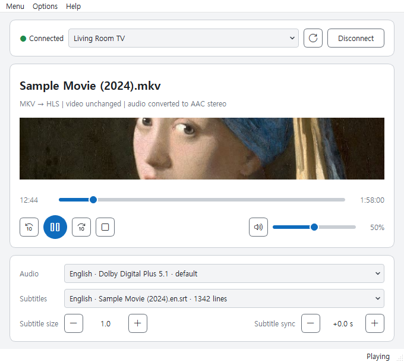

<p align="center">
  <strong>Language:</strong>
  <a href="README.md">English</a> |
  <a href="README.ko.md">한국어</a> |
  <a href="README.zh-CN.md">简体中文</a> |
  <a href="README.ja.md">日本語</a> |
  <a href="README.es.md">Español</a> |
  <a href="README.ru.md">Русский</a>
</p>

<p align="center"><sub>Este documento es una traducción automática con IA de la versión en inglés. Si hay diferencias, prevalece la versión en inglés.</sub></p>

<h1 align="center">CastPlayer</h1>

<p align="center">
  <a href="https://github.com/metapbl/CastPlayer/releases"></a>
  <a href="LICENSE"></a>
  <a href="#desde-el-código-fuente"></a>
  <a href="#requisitos"></a>
</p>

<p align="center">Una aplicación ligera para Windows que envía vídeos locales a Chromecast with Google TV. El PC es el mando; el televisor reproduce.</p>

<p align="center"></p>

## Funciones

- Abre mp4, mkv, avi, ts, mov y más, y elige un formato que el televisor pueda reproducir. Solo convierte cuando hace falta.
- La barra de búsqueda del televisor y del PC muestra la duración completa desde el principio, y se puede buscar con el mando del televisor.
- Selección de pista de audio, subtítulos (srt, smi, ass/ssa, vtt y subtítulos de texto dentro del vídeo), tamaño y sincronía de los subtítulos.
- Si la red se corta un rato (por ejemplo, al desconectar y volver a conectar el cable), la reproducción continúa donde estaba sin que tengas que hacer nada.
- La interfaz está disponible en English, 한국어, 简体中文, 日本語, Español y Русский.

## Capturas de pantalla

| Oscuro | Claro |
|---|---|
|  |  |

Miniatura de ejemplo: Johannes Vermeer, Girl with a Pearl Earring (c. 1665), public domain.

## Requisitos

- Windows 11 (Windows 10 puede funcionar, pero no se ha probado)
- Un Chromecast with Google TV en la misma red (subred)
- ffmpeg y ffprobe (ver [Instalación](#instalación); no se incluyen)

## Instalación

### Ejecutable (recomendado)

1. Descarga el zip desde [GitHub Releases](https://github.com/metapbl/CastPlayer/releases) y extráelo en cualquier carpeta.
2. Instala ffmpeg. En PowerShell o en el Símbolo del sistema:

   ```
   winget install Gyan.FFmpeg
   ```

3. Ejecuta `CastPlayer.exe`.

La aplicación busca ffmpeg primero en la carpeta `bin\` junto a `CastPlayer.exe` (`bin\ffmpeg.exe`, `bin\ffprobe.exe`) y después en el PATH.
Si no está en ninguno de los dos, muestra un mensaje al iniciarse y se cierra.

Si el Firewall de Windows pregunta en el primer inicio, permite el acceso en redes privadas.
El televisor obtiene el vídeo del puerto 8765 del PC.

### Desde el código fuente

Requiere Python 3.11 o posterior.

```
python -m venv .venv
.venv\Scripts\pip install -r requirements.txt
.venv\Scripts\python main.py
```

Añade `-v` para escribir un registro detallado (DEBUG) solo en esa ejecución.

## Uso

1. Al iniciarse, la aplicación busca dispositivos y se conecta al último que usaste. La primera vez, elige un dispositivo de la lista y pulsa **Conectar**.
2. Arrastra un archivo de vídeo a la ventana o ábrelo con `Ctrl+O`. Para detener la carga de un archivo grande, pulsa **Cancelar** o `Esc`.
3. Controla la reproducción con los botones de la ventana, los atajos de abajo o el mando del televisor.

Si tu dispositivo no aparece, usa **Menú → Añadir dispositivo por IP…** e introduce la dirección IP del televisor (por ejemplo `192.0.2.10`).

### Idioma de la interfaz

En el primer inicio, la aplicación sigue el idioma de visualización de Windows y usa English si ese idioma no es uno de los seis.
Cámbialo en **Opciones → Idioma**. El cambio se aplica al momento, sin reiniciar.

### Atajos de teclado

| Tecla | Acción |
|---|---|
| Space | Reproducir / Pausa |
| ← / → | Atrás / adelante 5 s (las pulsaciones seguidas se combinan en un solo salto) |
| ↑ / ↓ | Volumen ±5% |
| M | Activar/desactivar silencio |
| S | Detener (cierra el reproductor del televisor) |
| Ctrl+O | Abrir archivo |
| F5 | Buscar dispositivos de nuevo |
| Ctrl+Q | Salir |
| Mayús+clic | Botones de sincronía de subtítulos en pasos de 0,1 s |

### Modos de envío

| Modo | Cuándo | Qué hace |
|---|---|---|
| DIRECT | mp4 + H.264/HEVC + AAC/MP3, pista de audio predeterminada | Envía el archivo tal cual |
| REMUX | El televisor puede reproducir el vídeo, pero el contenedor o el códec de audio no encajan, o se elige otra pista de audio | Copia el vídeo y lo envía como HLS |
| TRANSCODE | Vídeo que el televisor no puede reproducir (XviD, H.264 de 10 bits, etc.) | Lo recodifica a H.264 y lo envía como HLS |

El audio se envía tal cual si es AAC; cualquier otro se convierte a AAC de 2 canales.

## Limitaciones

- Los subtítulos de imagen (PGS, VobSub) no son compatibles. Aparecen en gris en la lista.
- Solo se usa el Default Media Receiver del Chromecast. Al detener se cierra solo esa aplicación, así que las demás (como YouTube) no se tocan. Sin embargo, si envías un vídeo mientras se reproduce YouTube, este lo reemplaza, de modo que al detener el televisor vuelve a la pantalla de inicio.

## Archivos

Se crean junto al ejecutable (o a la carpeta del código fuente):

- `config.json` — último dispositivo, volumen, tamaño de subtítulos, idioma y otros ajustes (el puerto se cambia con `server_port`)
- `logs\castplayer.log` — registro. Desactivado por defecto; actívalo con **Opciones → Registro**. Se escribe de nuevo en cada ejecución (1 MB cada uno, hasta 4 archivos). Al ejecutar desde una terminal con `-v` se escribe un registro detallado (DEBUG) solo en esa ejecución
- `cache\` — caché de subtítulos; se borra al cerrar la aplicación (o con **Opciones → Vaciar caché…**)

## Problemas y contribuciones

Informa de errores y haz preguntas en [GitHub Issues](https://github.com/metapbl/CastPlayer/issues).
Las incidencias y las pull requests son bienvenidas, pero no se garantiza respuesta ni integración.

## Licencia

`MIT` — Copyright (c) 2026 META PUBLIC. Consulta [LICENSE](LICENSE).
Las licencias de las bibliotecas usadas están en [THIRD_PARTY_NOTICES.md](THIRD_PARTY_NOTICES.md).
ffmpeg no se incluye; cada usuario lo instala por separado.
