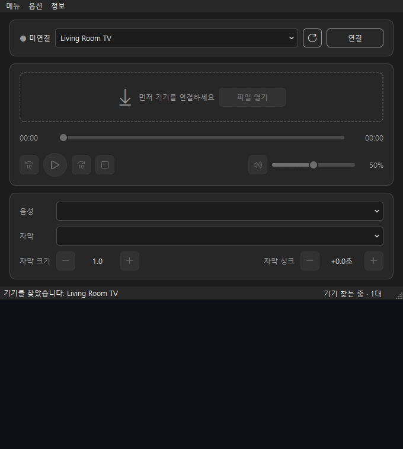
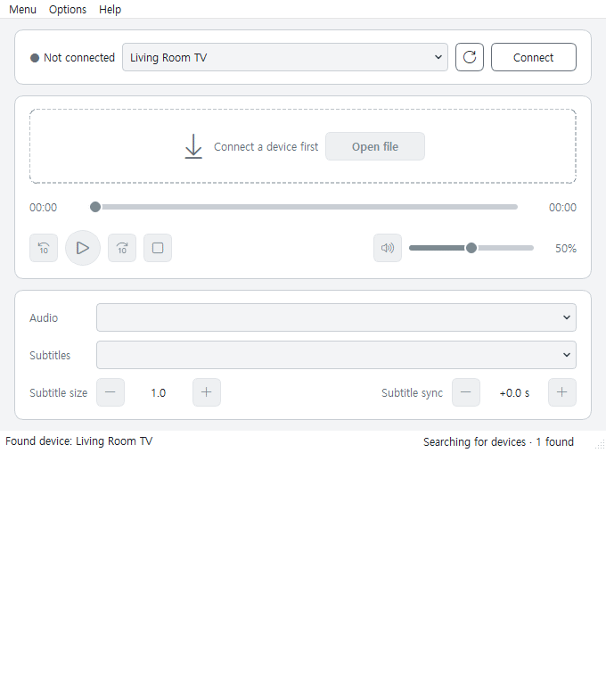

<p align="center">
  <strong>Language:</strong>
  <a href="README.md">English</a> |
  <a href="README.ko.md">한국어</a> |
  <a href="README.zh-CN.md">简体中文</a> |
  <a href="README.ja.md">日本語</a> |
  <a href="README.es.md">Español</a> |
  <a href="README.ru.md">Русский</a>
</p>

<p align="center"><sub>この文書は英語版を AI で翻訳したものです。内容が異なる場合は英語版に従ってください。</sub></p>

<h1 align="center">CastPlayer</h1>

<p align="center">
  <a href="https://github.com/metapbl/CastPlayer/releases"></a>
  <a href="LICENSE"></a>
  <a href="#ソースから実行"></a>
  <a href="#動作環境"></a>
</p>

<p align="center">ローカル動画を Chromecast with Google TV に送る軽量な Windows アプリ。PC はリモコン、再生はテレビが行います。</p>

## 機能

- mp4、mkv、avi、ts、mov などを開くと、テレビが再生できる形式を選んで送ります。変換は必要なときだけ行います。
- テレビと PC の両方のシークバーに最初から全体の長さが表示され、テレビのリモコンでもシークできます。
- 音声トラックの選択、字幕（srt、smi、ass/ssa、vtt、動画内のテキスト字幕）、字幕のサイズと同期の調整。
- ネットワークがしばらく切れても（LAN ケーブルを抜いて挿し直す程度）、何もしなくてもその位置から再生を続けます。
- 画面は English、한국어、简体中文、日本語、Español、Русский で使えます。

## スクリーンショット

| ダーク | ライト |
|---|---|
|  |  |

サンプルのサムネイル：Johannes Vermeer, Girl with a Pearl Earring (c. 1665), public domain.

## 動作環境

- Windows 11（Windows 10 でも動く可能性はありますが、テストしていません）
- 同じネットワーク（サブネット）にある Chromecast with Google TV
- ffmpeg と ffprobe（[インストール](#インストール)を参照。同梱していません）

## インストール

### 実行ファイル（推奨）

1. [GitHub Releases](https://github.com/metapbl/CastPlayer/releases) から zip をダウンロードし、任意のフォルダーに展開します。
2. ffmpeg をインストールします。PowerShell またはコマンドプロンプトで：

   ```
   winget install Gyan.FFmpeg
   ```

3. `CastPlayer.exe` を実行します。

ffmpeg は、まず `CastPlayer.exe` の隣の `bin\` フォルダー（`bin\ffmpeg.exe`、`bin\ffprobe.exe`）を探し、なければ PATH から探します。
どちらにもない場合は、起動時にメッセージを表示して終了します。

初回起動時に Windows ファイアウォールが確認してきたら、プライベートネットワークでのアクセスを許可してください。
テレビは PC のポート 8765 から動画を取得します。

### ソースから実行

Python 3.11 以降が必要です。

```
python -m venv .venv
.venv\Scripts\pip install -r requirements.txt
.venv\Scripts\python main.py
```

`-v` を付けると、その実行だけ詳細な（DEBUG）ログを書き出します。

## 使い方

1. 起動するとデバイスを探し、前回使ったデバイスに自動で接続します。初回は一覧からデバイスを選び、**接続** を押します。
2. 動画ファイルをウィンドウにドラッグするか、`Ctrl+O` で開きます。大きなファイルの読み込みを止めるには **キャンセル** または `Esc` を押します。
3. 再生の操作は、ウィンドウのボタン、下のショートカット、またはテレビのリモコンで行います。

デバイスが一覧に出てこない場合は、**メニュー → IP でデバイスを追加…** にテレビの IP アドレス（例：`192.0.2.10`）を入力してください。

### 画面の言語

初回起動時は Windows の表示言語に従い、6 つの言語にない場合は English になります。
**オプション → 言語** で変更でき、再起動しなくてもすぐに切り替わります。

### ショートカット

| キー | 動作 |
|---|---|
| Space | 再生 / 一時停止 |
| ← / → | 5 秒戻る / 進む（連打するとまとめて 1 回で移動） |
| ↑ / ↓ | 音量 ±5% |
| M | ミュート切り替え |
| S | 停止（テレビのプレーヤーを終了） |
| Ctrl+O | ファイルを開く |
| F5 | デバイスを再検索 |
| F1 | ヘルプ（ショートカットキーと対応形式） |
| Ctrl+Q | 終了 |
| Shift+クリック | 字幕同期ボタンを 0.1 秒単位で |

### 送信方式

| 方式 | いつ | 何をするか |
|---|---|---|
| DIRECT | mp4 + H.264/HEVC + AAC/MP3、既定の音声トラック | ファイルをそのまま送る |
| REMUX | テレビは映像を再生できるが、コンテナや音声コーデックが合わない、または別の音声トラックを選んだ | 映像はコピーし、HLS で送る |
| TRANSCODE | テレビが再生できない映像（XviD、10 ビット H.264 など） | H.264 に再エンコードし、HLS で送る |

音声は AAC ならそのまま、それ以外は 2 チャンネルの AAC に変換します。

## 制限

- 画像の字幕（PGS、VobSub）には対応していません。一覧ではグレーで表示されます。
- Chromecast の Default Media Receiver だけを使います。停止するとそのアプリだけを終了するので、ほかのアプリ（YouTube など）には影響しません。ただし、YouTube の再生中にこのアプリで動画を送ると YouTube と置き換わるため、停止後はテレビのホーム画面に戻ります。

## ファイルの場所

実行ファイル（またはソースフォルダー）の隣に次のものが作られます。

- `config.json` — 前回のデバイス、音量、字幕サイズ、言語などの設定（`server_port` でポートを変更可能）
- `logs\castplayer.log` — ログ。既定では書き出さず、**オプション → ログを記録** をオンにすると書き出します。起動のたびに新しく書きます（1 MB ずつ最大 4 個）。ターミナルから `-v` を付けて実行すると、その実行だけ詳細な（DEBUG）ログを書き出します
- `cache\` — 字幕のキャッシュ。アプリを閉じると削除（**オプション → キャッシュを消去…** でも消去）

## 問題報告と貢献

バグ報告や質問は [GitHub Issues](https://github.com/metapbl/CastPlayer/issues) へどうぞ。
Issue とプルリクエストは歓迎しますが、返信や取り込みは保証しません。

## ライセンス

`MIT` — Copyright (c) 2026 META PUBLIC。[LICENSE](LICENSE) を参照してください。
使用しているライブラリのライセンスは [THIRD_PARTY_NOTICES.md](THIRD_PARTY_NOTICES.md) にあります。
ffmpeg は同梱しておらず、利用者が別途インストールします。
