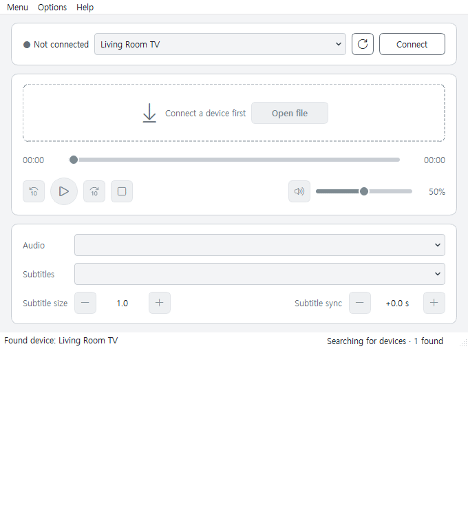
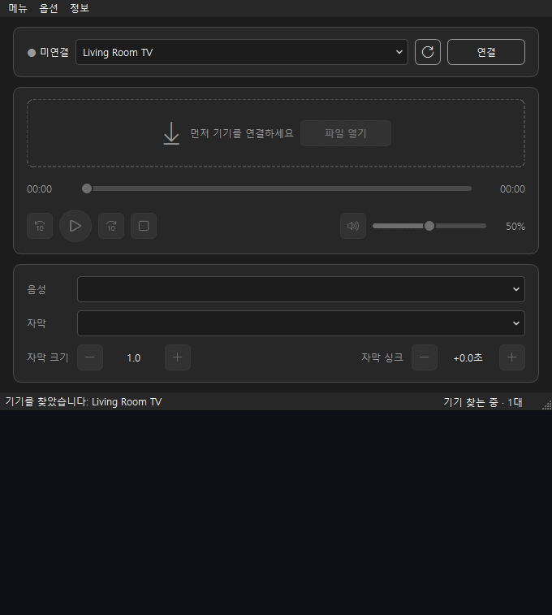

<p align="center">
  <strong>Language:</strong>
  <a href="README.md">English</a> |
  <a href="README.ko.md">한국어</a> |
  <a href="README.zh-CN.md">简体中文</a> |
  <a href="README.ja.md">日本語</a> |
  <a href="README.es.md">Español</a> |
  <a href="README.ru.md">Русский</a>
</p>

<p align="center"><sub>이 문서는 영어판을 AI로 번역한 것입니다. 내용이 다르면 영어판을 따릅니다.</sub></p>

<h1 align="center">CastPlayer</h1>

<p align="center">
  <a href="https://github.com/metapbl/CastPlayer/releases"></a>
  <a href="LICENSE"></a>
  <a href="#소스에서-실행"></a>
  <a href="#요구-사항"></a>
</p>

<p align="center">Windows PC의 로컬 동영상을 Chromecast with Google TV로 보내는 가벼운 프로그램. PC는 리모컨, 재생은 TV가 합니다.</p>

## 기능

- mp4, mkv, avi, ts, mov 등을 열면 TV가 재생할 수 있는 형태를 골라 보냅니다. 필요할 때만 변환합니다.
- TV와 PC 양쪽 탐색 바가 처음부터 전체 길이를 보이고, TV 리모컨으로도 탐색할 수 있습니다.
- 음성 트랙 선택, 자막(srt, smi, ass/ssa, vtt, 영상에 들어 있는 텍스트 자막), 자막 크기·싱크 조절.
- 네트워크가 잠시 끊겨도(랜선을 뽑았다 꽂는 정도) 손대지 않으면 그 자리에서 이어 재생합니다.
- 화면은 English, 한국어, 简体中文, 日本語, Español, Русский로 쓸 수 있습니다.

## 스크린샷

| 밝게 | 어둡게 |
|---|---|
|  |  |

예시 썸네일: Johannes Vermeer, Girl with a Pearl Earring (c. 1665), public domain.

## 요구 사항

- Windows 11 (Windows 10은 동작할 수 있으나 시험하지 않았습니다)
- 같은 네트워크(서브넷)에 있는 Chromecast with Google TV
- ffmpeg·ffprobe ([설치](#설치) 참고. 이 프로그램에 들어 있지 않습니다)

## 설치

### 실행 파일 (권장)

1. [GitHub Releases](https://github.com/metapbl/CastPlayer/releases)에서 zip을 받아 원하는 폴더에 풉니다.
2. ffmpeg를 설치합니다. PowerShell이나 명령 프롬프트에서:

   ```
   winget install Gyan.FFmpeg
   ```

3. `CastPlayer.exe`를 실행합니다.

ffmpeg는 `CastPlayer.exe` 옆의 `bin\` 폴더(`bin\ffmpeg.exe`, `bin\ffprobe.exe`)를 먼저 찾고, 없으면 PATH에서 찾습니다.
둘 다 없으면 시작할 때 안내창을 띄우고 종료합니다.

처음 실행할 때 Windows 방화벽이 허용 여부를 물으면 개인 네트워크에서 허용해 주세요.
TV가 PC의 포트 8765로 동영상을 받아 갑니다.

### 소스에서 실행

Python 3.11 이상이 필요합니다.

```
python -m venv .venv
.venv\Scripts\pip install -r requirements.txt
.venv\Scripts\python main.py
```

`-v`를 붙이면 이번 실행만 자세한 로그(DEBUG)를 남깁니다.

## 사용법

1. 실행하면 기기를 찾아 마지막에 쓴 기기에 자동으로 연결합니다. 처음이면 목록에서 기기를 고르고 **연결**을 누릅니다.
2. 동영상 파일을 창에 끌어다 놓거나 `Ctrl+O`로 엽니다. 큰 파일의 불러오기를 멈추려면 **취소**나 `Esc`를 누릅니다.
3. 재생 제어는 창의 버튼이나 아래 단축키, 또는 TV 리모컨으로 합니다.

기기가 목록에 나오지 않으면 **메뉴 → IP로 기기 추가…**에 TV의 IP 주소(예: `192.0.2.10`)를 넣어 보세요.

### 화면 언어

처음 실행하면 Windows 표시 언어를 따르고, 6개 언어에 없으면 English로 보입니다.
**옵션 → 언어**에서 바꿀 수 있고, 다시 켜지 않아도 바로 바뀝니다.

### 단축키

| 키 | 동작 |
|---|---|
| Space | 재생 / 일시정지 |
| ← / → | 5초 뒤로 / 앞으로 (연타하면 모아서 한 번에 이동) |
| ↑ / ↓ | 볼륨 ±5% |
| M | 음소거 전환 |
| S | 정지 (TV 플레이어 종료) |
| Ctrl+O | 파일 열기 |
| F5 | 기기 다시 찾기 |
| F1 | 도움말 (단축키·지원 형식) |
| Ctrl+Q | 프로그램 종료 |
| Shift+클릭 | 자막 싱크 버튼을 0.1초 단위로 |

### 송출 방식

| 방식 | 언제 | 하는 일 |
|---|---|---|
| DIRECT | mp4 + H.264/HEVC + AAC/MP3, 기본 음성 트랙 | 파일을 그대로 보냄 |
| REMUX | 영상은 TV가 재생할 수 있으나 컨테이너·음성 코덱이 맞지 않거나 다른 음성 트랙 선택 | 영상은 복사, HLS로 보냄 |
| TRANSCODE | TV가 재생할 수 없는 영상(XviD, H.264 10bit 등) | H.264로 다시 인코딩해 HLS로 보냄 |

음성은 AAC면 그대로, 나머지는 AAC 2채널로 변환합니다.

## 한계

- 그림으로 된 자막(PGS, VobSub)은 지원하지 않습니다. 목록에 회색으로 보입니다.
- Chromecast의 기본 미디어 수신 앱만 씁니다. 정지하면 그 앱만 종료하므로 다른 앱(유튜브 등)은 건드리지 않습니다. 다만 유튜브를 보던 중에 이 프로그램으로 동영상을 보내면 유튜브 자리를 대신하므로, 정지한 뒤에는 TV 홈 화면으로 돌아갑니다.

## 파일 위치

실행 파일(또는 소스 폴더) 옆에 다음이 생깁니다.

- `config.json` — 마지막 기기, 볼륨, 자막 크기, 언어 등 설정 (`server_port`로 포트 변경 가능)
- `logs\castplayer.log` — 로그. 기본은 남기지 않고, **옵션 → 로그 기록**을 켜면 남깁니다. 실행할 때마다 새로 씁니다 (1MB씩 최대 4개). 터미널에서 `-v`를 붙여 실행하면 이번 실행만 자세한(DEBUG) 로그를 남깁니다
- `cache\` — 자막 캐시. 프로그램을 끄면 지워짐 (**옵션 → 캐시 비우기…**로도 지움)

## 이슈와 기여

버그 신고와 질문은 [GitHub Issues](https://github.com/metapbl/CastPlayer/issues)에 남겨 주세요.
이슈와 풀 리퀘스트는 환영하지만, 답변이나 반영을 보장하지는 않습니다.

## 라이선스

`MIT` — Copyright (c) 2026 META PUBLIC. [LICENSE](LICENSE)를 보세요.
사용한 라이브러리의 라이선스는 [THIRD_PARTY_NOTICES.md](THIRD_PARTY_NOTICES.md)에 있습니다.
ffmpeg는 이 프로그램에 포함되지 않으며, 사용자가 따로 설치합니다.
