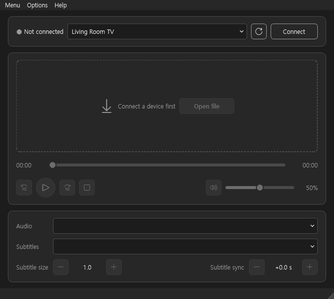
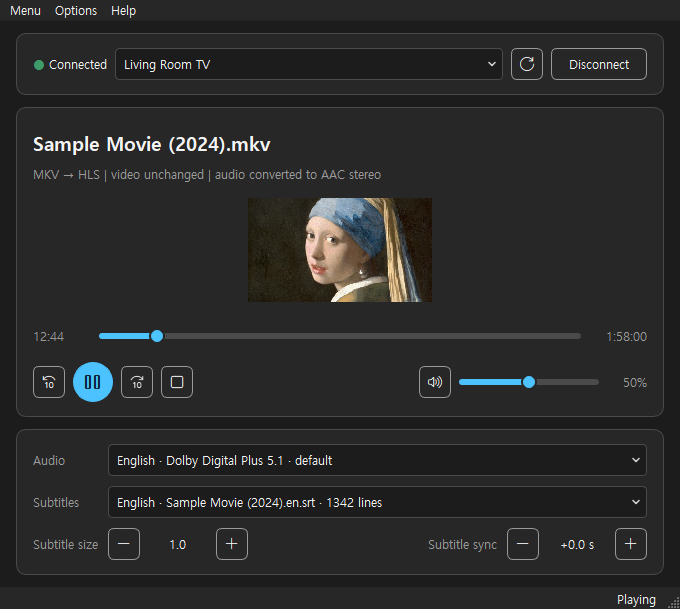
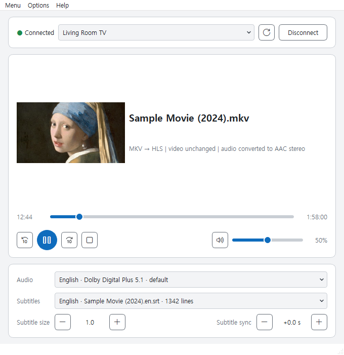

<p align="center">
  <strong>Language:</strong>
  <a href="README.md">English</a> |
  <a href="README.ko.md">한국어</a> |
  <a href="README.zh-CN.md">简体中文</a> |
  <a href="README.ja.md">日本語</a> |
  <a href="README.es.md">Español</a> |
  <a href="README.ru.md">Русский</a>
</p>

<h1 align="center">CastPlayer</h1>

<p align="center">
  <a href="https://github.com/metapbl/CastPlayer/releases"></a>
  <a href="LICENSE"></a>
  <a href="#from-source"></a>
  <a href="#requirements"></a>
</p>

<p align="center">A lightweight Windows app that casts local videos to Chromecast with Google TV. The PC is the remote; the TV plays.</p>

<p align="center"></p>

## Features

- Opens mp4, mkv, avi, ts, mov and more, and picks a form the TV can play. It converts only when needed.
- The seek bar on both the TV and the PC shows the full length from the start, and you can seek with the TV remote.
- Audio track selection, subtitles (srt, smi, ass/ssa, vtt, and text subtitles inside the video), subtitle size and sync.
- If the network drops for a while (such as unplugging and replugging the cable), playback resumes where it was without you touching anything.
- The interface is available in English, 한국어, 简体中文, 日本語, Español and Русский.

## Screenshots

| Dark | Light |
|---|---|
|  |  |

Sample thumbnail: Johannes Vermeer, Girl with a Pearl Earring (c. 1665), public domain.

## Requirements

- Windows 11 (Windows 10 may work but is not tested)
- A Chromecast with Google TV on the same network (subnet)
- ffmpeg and ffprobe (see [Installation](#installation); they are not included)

## Installation

### Executable (recommended)

1. Download the zip from [GitHub Releases](https://github.com/metapbl/CastPlayer/releases) and extract it to any folder.
2. Install ffmpeg. In PowerShell or Command Prompt:

   ```
   winget install Gyan.FFmpeg
   ```

3. Run `CastPlayer.exe`.

The app looks for ffmpeg first in the `bin\` folder next to `CastPlayer.exe` (`bin\ffmpeg.exe`, `bin\ffprobe.exe`), then on PATH.
If neither has it, the app shows a message on startup and exits.

If Windows Firewall asks on first run, allow access on private networks.
The TV fetches the video from port 8765 on the PC.

### From source

Requires Python 3.11 or later.

```
python -m venv .venv
.venv\Scripts\pip install -r requirements.txt
.venv\Scripts\python main.py
```

Add `-v` to write a detailed (DEBUG) log for that run only.

## Usage

1. On start, the app finds devices and connects to the one you used last. The first time, pick a device from the list and press **Connect**.
2. Drag a video file onto the window, or open one with `Ctrl+O`. To stop loading a large file, press **Cancel** or `Esc`.
3. Control playback with the window's buttons, the shortcuts below, or the TV remote.

If your device does not appear, use **Menu → Add device by IP…** and enter the TV's IP address (for example `192.0.2.10`).

### Interface language

On first start the app follows the Windows display language, and uses English if that language is not one of the six.
Change it in **Options → Language**. The change applies at once, without restarting.

### Shortcuts

| Key | Action |
|---|---|
| Space | Play / pause |
| ← / → | Back / forward 5 seconds (repeated presses are combined into one jump) |
| ↑ / ↓ | Volume ±5% |
| M | Toggle mute |
| S | Stop (closes the player on the TV) |
| Ctrl+O | Open file |
| F5 | Search for devices again |
| Ctrl+Q | Quit |
| Shift+click | Subtitle sync buttons in 0.1-second steps |

### Casting modes

| Mode | When | What it does |
|---|---|---|
| DIRECT | mp4 + H.264/HEVC + AAC/MP3, default audio track | Sends the file as is |
| REMUX | The TV can play the video, but the container or audio codec does not fit, or another audio track is chosen | Copies the video and sends it as HLS |
| TRANSCODE | Video the TV cannot play (XviD, 10-bit H.264, etc.) | Re-encodes to H.264 and sends it as HLS |

Audio is sent as is when it is AAC; anything else is converted to 2-channel AAC.

## Limitations

- Image-based subtitles (PGS, VobSub) are not supported. They appear greyed out in the list.
- Only the Chromecast's Default Media Receiver is used. Stopping closes only that app, so other apps (such as YouTube) are left alone. However, casting a video while YouTube is playing replaces YouTube, so after you stop, the TV returns to its home screen.

## Files

These are created next to the executable (or the source folder):

- `config.json` — last device, volume, subtitle size, language and other settings (change the port with `server_port`)
- `logs\castplayer.log` — log. Off by default; turn it on with **Options → Logging**. It starts fresh on every run (1 MB each, up to 4 files). Running from a terminal with `-v` writes a detailed (DEBUG) log for that run only
- `cache\` — subtitle cache (cleared with **Options → Clear cache…**)

## Issues and contributions

Report bugs and ask questions in [GitHub Issues](https://github.com/metapbl/CastPlayer/issues).
Issues and pull requests are welcome, but there is no guarantee of a response or a merge.

## License

`MIT` — Copyright (c) 2026 META PUBLIC. See [LICENSE](LICENSE).
Licenses of the libraries used are in [THIRD_PARTY_NOTICES.md](THIRD_PARTY_NOTICES.md).
ffmpeg is not included; users install it separately.
