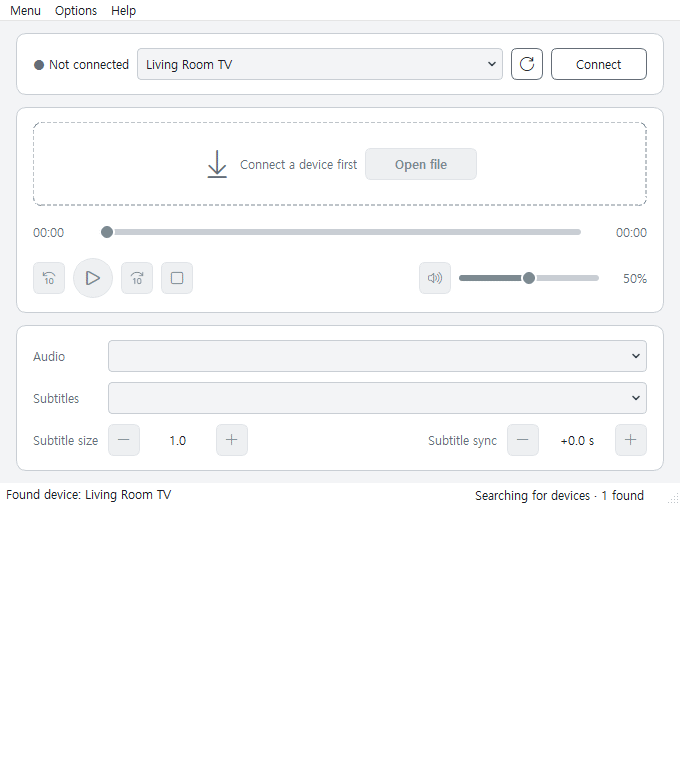
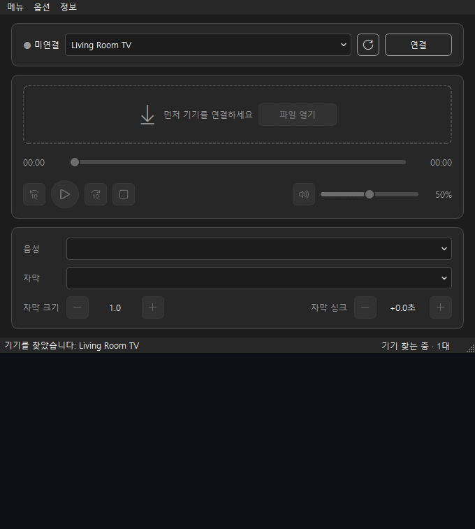

<p align="center">
  <strong>Language:</strong>
  <a href="README.md">English</a> |
  <a href="README.ko.md">한국어</a> |
  <a href="README.zh-CN.md">简体中文</a> |
  <a href="README.ja.md">日本語</a> |
  <a href="README.es.md">Español</a> |
  <a href="README.ru.md">Русский</a>
</p>

<p align="center"><sub>Этот документ переведён с английской версии с помощью ИИ. При расхождениях ориентируйтесь на английскую версию.</sub></p>

<h1 align="center">CastPlayer</h1>

<p align="center">
  <a href="https://github.com/metapbl/CastPlayer/releases"></a>
  <a href="LICENSE"></a>
  <a href="#запуск-из-исходного-кода"></a>
  <a href="#требования"></a>
</p>

<p align="center">Лёгкое приложение для Windows, которое передаёт локальные видео на Chromecast with Google TV. ПК — пульт, играет ТВ.</p>

## Возможности

- Открывает mp4, mkv, avi, ts, mov и другие форматы и выбирает вид, который ТВ может воспроизвести. Конвертирует только при необходимости.
- Полоса перемотки на ТВ и на ПК с самого начала показывает полную длительность, перематывать можно и пультом ТВ.
- Выбор звуковой дорожки, субтитры (srt, smi, ass/ssa, vtt и текстовые субтитры внутри видео), размер и синхронизация субтитров.
- Если сеть ненадолго пропадёт (например, кабель вынули и вставили обратно), воспроизведение продолжится с того же места без вашего участия.
- Интерфейс доступен на English, 한국어, 简体中文, 日本語, Español и Русский.

## Снимки экрана

| Светлая | Тёмная |
|---|---|
|  |  |

Пример миниатюры: Johannes Vermeer, Girl with a Pearl Earring (c. 1665), public domain.

## Требования

- Windows 11 (Windows 10 может работать, но не тестировалась)
- Chromecast with Google TV в той же сети (подсети)
- ffmpeg и ffprobe (см. [Установка](#установка); в комплект не входят)

## Установка

### Исполняемый файл (рекомендуется)

1. Скачайте zip со страницы [GitHub Releases](https://github.com/metapbl/CastPlayer/releases) и распакуйте в любую папку.
2. Установите ffmpeg. В PowerShell или командной строке:

   ```
   winget install Gyan.FFmpeg
   ```

3. Запустите `CastPlayer.exe`.

Приложение ищет ffmpeg сначала в папке `bin\` рядом с `CastPlayer.exe` (`bin\ffmpeg.exe`, `bin\ffprobe.exe`), затем в PATH.
Если его нет ни там, ни там, при запуске появится сообщение, и приложение закроется.

Если при первом запуске брандмауэр Windows спросит разрешение, разрешите доступ в частных сетях.
ТВ получает видео с порта 8765 на ПК.

### Запуск из исходного кода

Нужен Python 3.11 или новее.

```
python -m venv .venv
.venv\Scripts\pip install -r requirements.txt
.venv\Scripts\python main.py
```

С ключом `-v` подробный (DEBUG) журнал пишется только для этого запуска.

## Использование

1. При запуске приложение ищет устройства и подключается к последнему использованному. В первый раз выберите устройство в списке и нажмите **Подключить**.
2. Перетащите видеофайл в окно или откройте его через `Ctrl+O`. Чтобы прервать загрузку большого файла, нажмите **Отмена** или `Esc`.
3. Управляйте воспроизведением кнопками окна, сочетаниями клавиш ниже или пультом ТВ.

Если устройства нет в списке, выберите **Меню → Добавить устройство по IP…** и введите IP-адрес ТВ (например, `192.0.2.10`).

### Язык интерфейса

При первом запуске приложение следует языку интерфейса Windows, а если его нет среди шести, использует English.
Язык меняется в **Параметры → Язык** и применяется сразу, без перезапуска.

### Сочетания клавиш

| Клавиша | Действие |
|---|---|
| Space | Воспроизведение / пауза |
| ← / → | Назад / вперёд на 5 с (частые нажатия объединяются в одну перемотку) |
| ↑ / ↓ | Громкость ±5% |
| M | Вкл./выкл. звук |
| S | Стоп (закрывает плеер на ТВ) |
| Ctrl+O | Открыть файл |
| F5 | Искать устройства снова |
| F1 | Справка (сочетания клавиш и форматы) |
| Ctrl+Q | Выход |
| Shift+щелчок | Кнопки синхронизации субтитров с шагом 0,1 с |

### Режимы передачи

| Режим | Когда | Что делает |
|---|---|---|
| DIRECT | mp4 + H.264/HEVC + AAC/MP3, звуковая дорожка по умолчанию | Отправляет файл как есть |
| REMUX | ТВ может воспроизвести видео, но контейнер или аудиокодек не подходят, либо выбрана другая звуковая дорожка | Копирует видео и отправляет его как HLS |
| TRANSCODE | Видео, которое ТВ не может воспроизвести (XviD, 10-битный H.264 и т. п.) | Перекодирует в H.264 и отправляет как HLS |

Звук в AAC отправляется как есть, остальное конвертируется в двухканальный AAC.

## Ограничения

- Графические субтитры (PGS, VobSub) не поддерживаются. В списке они серые.
- Используется только Default Media Receiver на Chromecast. При остановке закрывается только это приложение, другие (например, YouTube) не затрагиваются. Но если отправить видео во время воспроизведения YouTube, оно заменит YouTube, поэтому после остановки ТВ вернётся на главный экран.

## Файлы

Рядом с исполняемым файлом (или папкой с исходным кодом) создаются:

- `config.json` — последнее устройство, громкость, размер субтитров, язык и другие настройки (порт меняется через `server_port`)
- `logs\castplayer.log` — журнал. По умолчанию выключен; включается через **Параметры → Вести журнал**. При каждом запуске пишется заново (по 1 МБ, до 4 файлов). При запуске из терминала с `-v` подробный (DEBUG) журнал пишется только для этого запуска
- `cache\` — кэш субтитров; удаляется при закрытии приложения (или через **Параметры → Очистить кэш…**)

## Вопросы и участие

Сообщайте об ошибках и задавайте вопросы в [GitHub Issues](https://github.com/metapbl/CastPlayer/issues).
Issues и pull requests приветствуются, но ответ или принятие изменений не гарантируются.

## Лицензия

`MIT` — Copyright (c) 2026 META PUBLIC. См. [LICENSE](LICENSE).
Лицензии используемых библиотек — в [THIRD_PARTY_NOTICES.md](THIRD_PARTY_NOTICES.md).
ffmpeg не входит в комплект, пользователь устанавливает его отдельно.
