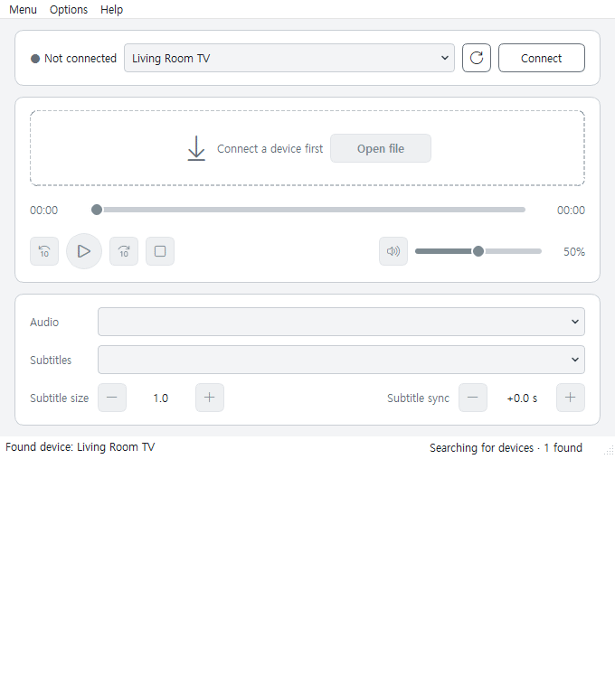
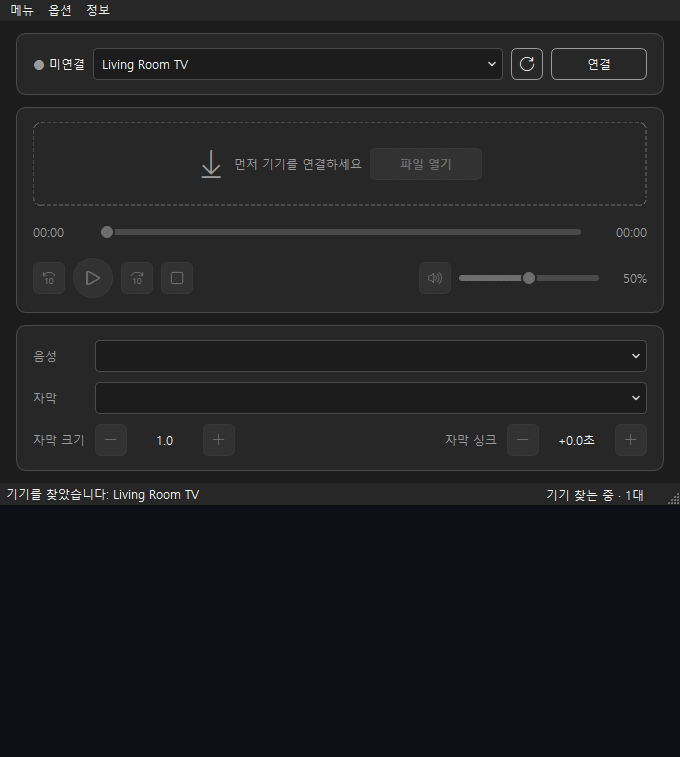

<p align="center">
  <strong>Language:</strong>
  <a href="README.md">English</a> |
  <a href="README.ko.md">한국어</a> |
  <a href="README.zh-CN.md">简体中文</a> |
  <a href="README.ja.md">日本語</a> |
  <a href="README.es.md">Español</a> |
  <a href="README.ru.md">Русский</a>
</p>

<p align="center"><sub>本文档由 AI 从英文版翻译而来。如有出入，以英文版为准。</sub></p>

<h1 align="center">CastPlayer</h1>

<p align="center">
  <a href="https://github.com/metapbl/CastPlayer/releases"></a>
  <a href="LICENSE"></a>
  <a href="#从源码运行"></a>
  <a href="#系统要求"></a>
</p>

<p align="center">一款轻量的 Windows 应用，把本地视频投放到 Chromecast with Google TV。PC 只当遥控器，由电视播放。</p>

## 功能

- 可打开 mp4、mkv、avi、ts、mov 等格式，并选择电视能播放的形式发送。仅在需要时才转换。
- 电视和 PC 两边的进度条从一开始就显示完整时长，也可以用电视遥控器跳转。
- 选择音轨，字幕（srt、smi、ass/ssa、vtt 以及视频内的文本字幕），调整字幕大小和同步。
- 网络短暂中断时（例如拔掉网线再插上），无需任何操作即可从原位置继续播放。
- 界面支持 English、한국어、简体中文、日本語、Español 和 Русский。

## 截图

| 浅色 | 深色 |
|---|---|
|  |  |

示例缩略图：Johannes Vermeer, Girl with a Pearl Earring (c. 1665), public domain.

## 系统要求

- Windows 11（Windows 10 可能可用，但未经测试）
- 同一网络（子网）中的 Chromecast with Google TV
- ffmpeg 和 ffprobe（见[安装](#安装)；本程序不附带）

## 安装

### 可执行文件（推荐）

1. 从 [GitHub Releases](https://github.com/metapbl/CastPlayer/releases) 下载 zip，解压到任意文件夹。
2. 安装 ffmpeg。在 PowerShell 或命令提示符中运行：

   ```
   winget install Gyan.FFmpeg
   ```

3. 运行 `CastPlayer.exe`。

程序先在 `CastPlayer.exe` 旁边的 `bin\` 文件夹（`bin\ffmpeg.exe`、`bin\ffprobe.exe`）中查找 ffmpeg，找不到再从 PATH 中查找。
两处都没有时，程序会在启动时显示提示并退出。

首次运行时如果 Windows 防火墙询问，请允许在专用网络上访问。
电视会从 PC 的 8765 端口获取视频。

### 从源码运行

需要 Python 3.11 或更高版本。

```
python -m venv .venv
.venv\Scripts\pip install -r requirements.txt
.venv\Scripts\python main.py
```

加上 `-v` 时，仅本次运行写入详细（DEBUG）日志。

## 使用方法

1. 启动后，程序会搜索设备并自动连接上次使用的设备。首次使用时，从列表中选择设备并按 **连接**。
2. 把视频文件拖到窗口上，或用 `Ctrl+O` 打开。要停止加载大文件，按 **取消** 或 `Esc`。
3. 用窗口中的按钮、下面的快捷键或电视遥控器控制播放。

如果设备没有出现在列表中，请用 **菜单 → 按 IP 添加设备…** 输入电视的 IP 地址（例如 `192.0.2.10`）。

### 界面语言

首次启动时跟随 Windows 显示语言；如果该语言不在这六种之中，则使用 English。
可在 **选项 → 语言** 中更改，无需重启即可立即生效。

### 快捷键

| 键 | 操作 |
|---|---|
| Space | 播放 / 暂停 |
| ← / → | 后退 / 前进 5 秒（连按时合并为一次跳转） |
| ↑ / ↓ | 音量 ±5% |
| M | 切换静音 |
| S | 停止（关闭电视播放器） |
| Ctrl+O | 打开文件 |
| F5 | 重新搜索设备 |
| F1 | 帮助（快捷键与支持格式） |
| Ctrl+Q | 退出 |
| Shift+单击 | 字幕同步按钮改为 0.1 秒步进 |

### 投放方式

| 方式 | 何时 | 做什么 |
|---|---|---|
| DIRECT | mp4 + H.264/HEVC + AAC/MP3，默认音轨 | 直接发送文件 |
| REMUX | 电视能播放视频，但容器或音频编码不合适，或选择了其他音轨 | 复制视频，以 HLS 发送 |
| TRANSCODE | 电视无法播放的视频（XviD、10 位 H.264 等） | 重新编码为 H.264，以 HLS 发送 |

音频为 AAC 时直接发送，其他格式转换为双声道 AAC。

## 限制

- 不支持图像字幕（PGS、VobSub），它们在列表中显示为灰色。
- 只使用 Chromecast 的默认媒体接收器。停止时只关闭该应用，不影响其他应用（如 YouTube）。但如果在播放 YouTube 时用本程序投放视频，会取代 YouTube，因此停止后电视会回到主屏幕。

## 文件位置

以下文件会创建在可执行文件（或源码文件夹）旁边：

- `config.json` — 上次的设备、音量、字幕大小、语言等设置（可用 `server_port` 更改端口）
- `logs\castplayer.log` — 日志。默认不记录，在 **选项 → 记录日志** 中开启。每次运行重新写入（每个 1 MB，最多 4 个）。在终端中加 `-v` 运行时，仅本次运行写入详细（DEBUG）日志
- `cache\` — 字幕缓存，程序关闭时删除（也可用 **选项 → 清除缓存…** 清除）

## 问题与贡献

请在 [GitHub Issues](https://github.com/metapbl/CastPlayer/issues) 中报告错误和提问。
欢迎提交问题和拉取请求，但不保证回复或合并。

## 许可证

`MIT` — Copyright (c) 2026 META PUBLIC。见 [LICENSE](LICENSE)。
所用库的许可证见 [THIRD_PARTY_NOTICES.md](THIRD_PARTY_NOTICES.md)。
本程序不包含 ffmpeg，需要用户另行安装。
